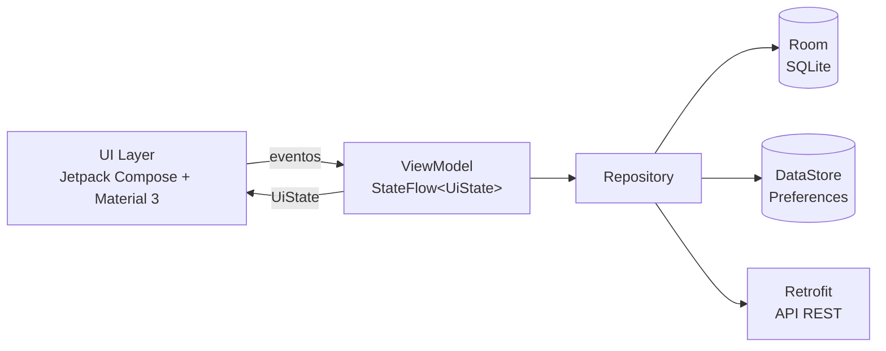

<div align="center">


# Chega Aí

**Carona universitária: combinou, chegou.**

Aplicativo Android nativo para alunos, professores e colaboradores de uma faculdade organizarem **caronas compartilhadas** entre bairros e cidades vizinhas.


-3DDC84?logo=android&logoColor=white>)


</div>

---

## Sumário

1. [Sobre o projeto](#1-sobre-o-projeto)
2. [Funcionalidades](#2-funcionalidades)
3. [Arquitetura](#3-arquitetura)
4. [Tecnologias](#4-tecnologias)
5. [Requisitos técnicos atendidos](#5-requisitos-técnicos-atendidos)
6. [Estrutura do repositório](#6-estrutura-do-repositório)
7. [Como compilar e executar](#7-como-compilar-e-executar)
8. [Roteiro de demonstração](#8-roteiro-de-demonstração)
9. [Versionamento e colaboração](#9-versionamento-e-colaboração)
10. [Limitações e próximos passos](#10-limitações-e-próximos-passos)
11. [Autoria](#11-autoria)

---

## 1. Sobre o projeto

**Tema do catálogo:** _Carona Solidária e Sustentável Universitária — Mobilidade & Comunidade_.

### Problema social

Muitos estudantes dependem de transporte caro, escasso ou demorado para chegar ao campus, enquanto vários carros circulam com vagas vazias. O resultado é gasto elevado para quem não tem carro, emissões desnecessárias e pouca integração da comunidade acadêmica.

### Proposta (MVP)

O **Chega Aí** conecta quem **oferece** carona a quem **precisa**, dentro de uma comunidade fechada: o acesso é restrito a quem tem **e-mail institucional**.

- **Reduzir custos** de deslocamento de estudantes e colaboradores.
- **Reduzir emissões** ao aumentar a ocupação dos veículos (mobilidade sustentável).
- **Fortalecer a comunidade** acadêmica com contatos, vínculo (curso/professor) e chat entre quem divide a viagem.
- **Dar segurança**: somente pessoas com e-mail acadêmico participam.

### Contexto acadêmico

Projeto da disciplina de desenvolvimento mobile, com foco em Kotlin idiomático, Jetpack Compose, MVVM, navegação, persistência local (Room e DataStore) e consumo de API REST.

---

## 2. Funcionalidades

| Módulo        | Funcionalidade                                                                                  | Onde está                                      |
| ------------- | ----------------------------------------------------------------------------------------------- | ---------------------------------------------- |
| Acesso        | Cadastro e login restritos a e-mail institucional (Estudante com curso, Professor(a), Colaborador(a)) | `EmailPolicy`, `AuthRepository`, `AuthScreens` |
| **Caronas**   | Oferecer carona (rota aproximada, horário, vagas), editar e excluir                             | `RideFormScreen`, `RideDetailScreen`           |
| **Caronas**   | Listar com busca e filtros (com vagas, meus contatos, período)                                  | `RideListScreen`                               |
| **Caronas**   | Solicitar vaga, confirmar, recusar e cancelar                                                   | `RideDetailScreen`, `RequestRepository`        |
| **Caronas**   | Ver a rota saída → destino no Google Maps (abre o app de mapas, sem chave de API)               | `RideDetailScreen`, `ui/util/Intents.kt`       |
| **Caronas**   | Chat entre motorista e passageiro                                                               | `ChatScreen`, `ChatRepository`                 |
| **Atividade** | Métricas, caronas oferecidas, solicitações e limpar histórico                                   | `ActivityScreen`                               |
| **Contatos**  | Adicionar por e-mail institucional e remover                                                    | `ContactsScreen`, `ContactRepository`          |
| **Perfil**    | Foto, editar nome/curso, alterar senha, tema claro/escuro e sair                                | `ProfileScreen`, `ProfileRepository`           |

---

## 3. Arquitetura

O app segue **MVVM em camadas estritas** com **fluxo de dados unidirecional (UDF)**:

```
UI Layer  →  ViewModel  →  Repository  →  Data Source (Room · DataStore · Retrofit)
```



### Responsabilidade de cada camada

| Camada      | Pacote                      | Responsabilidade                                                                                                              |
| ----------- | --------------------------- | ----------------------------------------------------------------------------------------------------------------------------- |
| UI          | `ui/<módulo>`               | Telas Compose _stateless_ (`Screen`) e um `Route` que coleta o `StateFlow` da ViewModel                                       |
| ViewModel   | `ui/<módulo>/*ViewModel`    | Mantém o `UiState` (`StateFlow`), recebe eventos da UI, abre/fecha diálogos e chama os repositórios. Nunca recebe `Context`   |
| Repository  | `data/repository`           | Regras de negócio e orquestração das fontes de dados                                                                          |
| Data Source | `data/local`, `data/remote` | Room (entidades e DAOs), DataStore (preferências) e Retrofit (API REST)                                                       |
| Domínio     | `domain`                    | Modelos puros (`data class`, `enum`) e validações sem dependência de Android                                                  |

### Decisões de arquitetura

- **Estado previsível:** cada tela expõe um `UiState` modelado com `sealed interface` (`Loading`, `Error`, `Success`). Eventos de uso único (Snackbar, voltar) saem por `SharedFlow<UiEvent>`.
- **Offline-first:** o Room é a fonte da verdade. `RideRepository.refresh()` envia as caronas pendentes (`synced = false`) e depois baixa o estado do servidor. Sem rede o app continua funcionando.
- **Navegação:** `AuthNavHost` (login e cadastro) e `MainNavHost` com barra inferior e 4 grafos aninhados. A sessão salva no DataStore decide qual dos dois aparece.
- **Injeção de dependências manual:** `AppContainer` cria banco, DataStore, Retrofit e repositórios, e `ViewModelFactories` monta cada ViewModel. É o único ponto que conhece `Context`.

Detalhes completos em [`docs/ARQUITETURA.md`](docs/ARQUITETURA.md).

---

## 4. Tecnologias

| Camada        | Tecnologia                                 | Versão      | Para que serve                                       |
| ------------- | ------------------------------------------ | ----------- | ---------------------------------------------------- |
| Linguagem     | Kotlin                                     | 2.0.21      | Código idiomático: null safety, `sealed`, extensions |
| Interface     | Jetpack Compose + Material 3 (BOM)         | 2024.10.01  | UI declarativa, 100 % em Kotlin, sem layout XML      |
| Navegação     | Navigation Compose                         | 2.8.4       | `NavHost`, grafos aninhados e back stack             |
| Arquitetura   | Lifecycle ViewModel + StateFlow            | 2.8.7       | Estado sobrevive à rotação; fluxo unidirecional      |
| Assíncrono    | Kotlin Coroutines + Flow                   | 1.9.0       | Operações em `Dispatchers.IO` e dados reativos       |
| Banco local   | Room (KSP)                                 | 2.6.1       | Persistência em SQLite com consultas reativas        |
| Preferências  | DataStore Preferences                      | 1.1.1       | Sessão, tema e último filtro                         |
| Rede          | Retrofit + OkHttp + kotlinx.serialization  | 2.11 / 4.12 / 1.7.3 | Consumo da API REST e conversão JSON         |
| Imagens       | Coil                                       | 2.7.0       | Exibir a foto de perfil                              |
| Backend dev   | Node.js + json-server                      | 0.17.4      | API REST simulada para desenvolvimento               |
| Qualidade     | JUnit + Prettier                           | 4.13.2      | Testes unitários e formatação de JSON/Markdown       |

Mais detalhes em [`docs/TECNOLOGIAS.md`](docs/TECNOLOGIAS.md).

---

## 5. Requisitos técnicos atendidos

| Requisito                                | Implementação                                                                                                                  |
| ---------------------------------------- | ------------------------------------------------------------------------------------------------------------------------------ |
| **3.1** Kotlin idiomático                | `sealed interface` para `UiState` e diálogos, `data class`, null safety, extension functions, coleções funcionais              |
| **3.2** 100 % Compose + Material 3       | `Scaffold`, `TopAppBar`, `NavigationBar`, `FloatingActionButton`, `Card`, `FilterChip`, `TabRow`, `DatePicker`, `AlertDialog`  |
| **3.2** UDF e state hoisting             | Telas _stateless_ recebem `UiState` e callbacks; `rememberSaveable` só para estado visual; `LazyColumn` com estado de lista vazia |
| **3.3** MVVM e fluxo reativo             | UI → ViewModel → Repository → Data Source; ViewModels expõem só `StateFlow`/`SharedFlow` e **não recebem `Context`**           |
| **3.4** Navegação estruturada            | `NavHost` de autenticação e `NavHost` principal com `NavigationBar` e 4 módulos (Caronas, Atividade, Contatos, Perfil)         |
| **3.5** Diálogos de confirmação          | `AlertDialog` ao excluir carona, descartar alterações, cancelar solicitação, recusar passageiro, limpar histórico, remover contato/foto e sair; estado controlado na ViewModel |
| **3.6** Coroutines + REST                | `viewModelScope`, funções `suspend`, `Dispatchers.IO`, Retrofit com kotlinx.serialization; lista com **Loading / Success / Error** e "Tentar novamente" |
| **3.7** Room                             | 5 entidades (`users`, `rides`, `ride_requests`, `messages`, `contacts`), DAOs com CRUD e `Flow<List<T>>`, `CaronaDatabase` e padrão Repository |
| **3.7** Preferências                     | DataStore guarda sessão ativa, tema (claro/escuro/sistema) e último filtro da lista                                            |

---

## 6. Estrutura do repositório

```
chega-ai/
├── frontend/   aplicativo Android (Kotlin + Jetpack Compose); abra esta pasta no Android Studio
│   ├── app/    código-fonte, recursos (res/values, res/xml, res/drawable) e testes
│   └── gradle/ catálogo de versões e wrapper
├── backend/    API REST de desenvolvimento (json-server): db.json e package.json
├── docs/       documentação (arquitetura, tecnologias) e logo
├── README.md
├── CONTRIBUTING.md
├── .prettierrc.json
└── .gitignore
```

Organização dos pacotes em `frontend/app/src/main/java/br/com/habil/carona`:

```
data/      local (Room, DataStore), remote (Retrofit), repository, mapper
domain/    model e validações
ui/        auth, rides, activity, contacts, profile, chat, components, navigation, theme
```

---

## 7. Como compilar e executar

### Pré-requisitos

- **Android Studio** recente, com **JDK 17** e **Android SDK Platform 35**.
- Emulador ou aparelho com **Android 8.0 (API 26)** ou superior.
- **Node.js** (apenas para o backend de desenvolvimento).

### 1. Backend (API REST de desenvolvimento)

```bash
cd backend
npm install
npm start
```

A API sobe em `http://localhost:3000/`. O emulador acessa o computador em `http://10.0.2.2:3000/`, que é o valor padrão de `apiBaseUrl` em `frontend/gradle.properties`.

| Método | Rota         | Descrição           |
| ------ | ------------ | ------------------- |
| GET    | `/rides`     | Lista as caronas    |
| POST   | `/rides`     | Cria uma carona     |
| PUT    | `/rides/:id` | Atualiza uma carona |
| DELETE | `/rides/:id` | Remove uma carona   |

Para usar outro servidor (por exemplo MockAPI), altere `apiBaseUrl` em `frontend/gradle.properties` ou passe `-PapiBaseUrl=https://seu-projeto.mockapi.io/` ao compilar.

### 2. Frontend (aplicativo Android)

1. Abra a pasta `frontend` no Android Studio e aguarde o _Gradle Sync_ (usa Gradle 8.9, definido em `gradle-wrapper.properties`).
2. Crie ou inicie um emulador (API 26 ou superior).
3. Execute a configuração **app** (botão ▶️).

Para rodar os testes unitários, use o Android Studio (clique direito em `app/src/test` → _Run Tests_) ou, com Gradle 8.9 instalado, dentro de `frontend`:

```bash
gradle testDebugUnitTest
```

> Se o app abrir mas a lista de caronas mostrar erro de rede, confirme que o backend está rodando. O app continua utilizável offline e tenta sincronizar quando a rede voltar.

---

## 8. Roteiro de demonstração

1. Cadastrar com e-mail `@...edu.br` (e-mails pessoais são recusados).
2. Aba **Caronas**: lista vinda da API, busca e filtros (o último filtro fica salvo).
3. **Oferecer carona** e voltar com alterações pendentes para ver o `AlertDialog` de descarte.
4. Sair, criar **outro usuário**, solicitar vaga e abrir o **chat**.
5. Entrar como motorista, **confirmar** o passageiro (as vagas diminuem) ou recusar.
6. Aba **Atividade**: métricas, cancelar solicitação e **limpar histórico**.
7. Aba **Contatos**: adicionar um colega pelo e-mail e remover.
8. Aba **Perfil**: trocar foto, editar curso, alterar senha, mudar tema e sair.

---

## 9. Versionamento e colaboração

- **Repositório:** GitHub.
- **Commits:** padrão [Conventional Commits](https://www.conventionalcommits.org/pt-br/) (`feat:`, `fix:`, `refactor:`, `style:`, `test:`, `docs:`, `build:`, `chore:`).
- **Branches:** uma por funcionalidade, a partir da `main` (ex.: `feature/menu-navegacao`, `feature/room-database`), integradas por Pull Request.
- Regras completas em [`CONTRIBUTING.md`](CONTRIBUTING.md).

---

## 10. Limitações e próximos passos

### Limitações do MVP

- A autenticação é local (senha com SHA-256 e salt, guardada no Room); em produção seria necessário um backend.
- Solicitações, chat, contatos e foto ficam no banco do aparelho; para conversar entre aparelhos seria preciso uma API.
- A exclusão de uma carona já sincronizada exige conexão com o servidor.

### Próximos passos

- Backend real com autenticação e verificação do e-mail institucional.
- Solicitações e chat em tempo real entre aparelhos.
- Mapa embutido com a rota e pontos de encontro.
- Avaliações de motoristas e passageiros.

---

## 11. Autoria

**Integrante**

- José Pedro Jakiemiu

**Projeto:** Chega Aí · **Tema:** Carona Solidária e Sustentável Universitária
